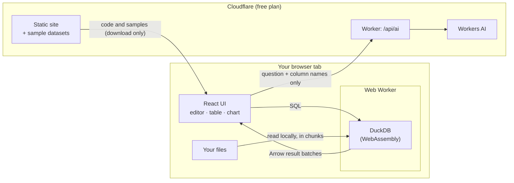

# Querylite

**Drop in a CSV and query millions of rows instantly, right in your browser. Nothing is uploaded.**

[](https://github.com/adamchebil33/querylite/actions/workflows/ci.yml)

**Live demo:** <!-- LIVE_DEMO_URL -->_coming soon_<!-- /LIVE_DEMO_URL -->. Click **Try it on 2.9 million taxi trips**: no file, no sign-up.


Querylite is a SQL playground where the database runs inside the browser tab. Drag in a CSV, TSV, JSON, Parquet or Excel file, ask questions in SQL or in plain English, and get a results table and a chart. It handles files far too big for a spreadsheet, and private data (bank exports, company sales) never leaves your computer because there is no server to send it to.

## Measured performance

Run on the built-in [`/bench`](src/bench/benchmark.ts) page, which anyone can re-run on their own device.

Measured on Chrome, Linux, 4 CPU threads, 8+ GB RAM, 2026-04-30, DuckDB (WebAssembly, single thread).

| Query over 2,869,937 rows | Median | Fastest |
| --- | ---: | ---: |
| Count all rows | 3.0 ms | 1.9 ms |
| Filter and aggregate | 31 ms | 25 ms |
| Group by hour (24 groups) | 40 ms | 36 ms |
| Group by route (tens of thousands of groups) | 53 ms | 46 ms |
| Join to zones and group by borough | 32 ms | 27 ms |
| Median and 95th percentile per payment type | 182 ms | 172 ms |
| Top 100 by tip (sort) | 48 ms | 44 ms |
| Daily totals with 7-day moving average (window) | 32 ms | 25 ms |

- Download and load 2,869,937 rows (18 MB Parquet): 1.9 s
- Parse a 59 MB CSV with 1,000,000 rows: 0.8 s

Each query runs once to warm up, then five times; the table shows the median and the fastest run.

## Features

- **Files:** CSV, TSV, JSON, Parquet and Excel (.xlsx). Drop several at once; each becomes a table, and joins across them work.
- **Editor:** SQL highlighting, autocomplete for table and column names, Ctrl/Cmd+Enter to run, and a Cancel button for long queries.
- **Results:** a virtualized table that scrolls 100,000 rows smoothly, click-to-sort, and a summary like `10 rows · 32 ms over 2,870,202 rows`.
- **Charts:** a bar, line or scatter chart is suggested from the shape of the result, with controls to change it.
- **Export:** the full result as CSV or Parquet, even when the on-screen table is cut off.
- **Plain English:** describe what you want and AI drafts the SQL. It is shown in the editor for you to review; it is never run automatically.
- **Explain and fix:** one click to explain a query, or to suggest a fix for an error.
- **Share:** a link that carries the SQL and the name of a sample dataset, never your data.
- **History and saved queries,** kept in your browser only.
- **Dark mode,** following the system setting.

## How it works



**DuckDB compiled to WebAssembly.** [DuckDB](https://duckdb.org) is a full analytical SQL database (joins, window functions, Parquet, the lot). Its WebAssembly build runs it inside the page, so queries execute on your CPU with no server round trip.

**Off the main thread.** The database lives in a Web Worker. Files are handed to it as browser file handles and read there in chunks, so nothing heavy ever runs on the UI thread. A test loads a million-row CSV while measuring the gap between animation frames to prove the page stays responsive.

**Streaming results.** Results come back as Apache Arrow record batches. The app stops reading after 100,000 rows for display, and the table only renders the rows in view, reading cells straight from the Arrow columns on demand. Sorting a cut-off result re-runs the query with an `ORDER BY`, so the database sorts the whole result rather than the visible part.

**Privacy by design, and enforced.**
- Your files are never uploaded. There is no upload endpoint to send them to.
- A Content-Security-Policy ([`public/_headers`](public/_headers)) makes the browser itself refuse connections to anything except this site and the two hosts the database engine is downloaded from. A bug or a compromised dependency could not send data elsewhere.
- Tests assert that loading files contacts no other host and sends no request body, and that a `POST` to an outside site is blocked.

**AI that never sees your data.** The plain-English feature sends your question and the *schema*: table names, column names and column types. It never sends rows, cell values, file names or file contents.
- The request is built from a whitelist of fields ([`shared/ai.ts`](shared/ai.ts)), and the Worker validates it again and drops anything unexpected.
- Database error messages can quote a cell value, so values are masked before an error is sent for fixing.
- AI-written SQL is parsed by DuckDB and accepted only if it is exactly one read-only `SELECT`. `DROP`, `DELETE`, `COPY` and multi-statement answers are discarded.
- A unit test and a browser test check the outgoing request for every value in the test files.
- When you use Explain or Fix, the SQL you typed is sent as written.

The AI runs on Cloudflare Workers AI behind a small Worker that rate-limits each visitor. If it is down, rate-limited or the free daily allowance is used up, the app says so and everything else keeps working.

**Sharing queries without sharing data.** A share link is `…/app#data=taxi&sql=…`. It holds the SQL and the id of a built-in sample dataset. Everything after `#` stays in the browser and is never sent to a server.

## Tech stack

React, TypeScript and Vite · DuckDB-WASM · Apache Arrow · CodeMirror 6 · Observable Plot · TanStack Virtual · Tailwind CSS · Cloudflare Workers and Workers AI · Vitest and Playwright.

## Run it locally

Requires Node.js 22 or newer.

```bash
git clone https://github.com/adamchebil33/querylite.git
cd querylite
npm install
npm run dev
```

Open the printed URL. No account or configuration is needed. Locally the AI buttons report that AI is unavailable, because the model only runs on Cloudflare's network; everything else works. To use the real model locally, run `npx wrangler login` once and then `npm run dev:ai`.

## Test

```bash
npm test                  # unit tests (Vitest)
npx playwright install chromium   # once
npm run test:e2e          # browser tests against the dev server
npm run test:e2e:preview  # browser tests against the production build, with its security headers
```

The browser tests start the app themselves and need internet access, because the database engine is downloaded from a CDN.

What they cover: loading every file format, joins across files, value formatting, sorting, charts, exports, share links, the benchmark page, that the page stays responsive during a large load, that nothing is uploaded, and that AI requests never contain data values.

## Deploy

The whole app, including the AI endpoint, runs on Cloudflare's free plan. You need a GitHub account and a Cloudflare account; no credit card.

**First deploy, from your machine:**

```bash
npx wrangler login   # opens the browser to authorise your Cloudflare account
npm run deploy       # builds, then uploads the site and the Worker
```

Wrangler prints the live URL, `https://querylite.<your-subdomain>.workers.dev`. The first time, it asks you to choose that subdomain.

**Automatic deploys on every push (optional):** in the Cloudflare dashboard, open *Workers & Pages*, select the `querylite` Worker, then *Settings → Builds → Connect* and pick this GitHub repository. Use `npm run build` as the build command and `npx wrangler deploy` as the deploy command. Cloudflare then builds and deploys each push to `main`. No GitHub secrets are needed.

**Staying free:** on the Workers Free plan, Workers AI has a daily allowance. When it is used up, AI requests fail with an error and the app shows a friendly message; nothing is billed. Billing only starts if you subscribe to the Workers Paid plan.

**Configuration** lives in [`wrangler.jsonc`](wrangler.jsonc): the Worker name, the AI model (`AI_MODEL`) and the per-visitor rate limit (5 AI requests per minute).

## Project structure

```
src/
  main.tsx          page switching: landing (/), editor (/app), benchmark (/bench)
  App.tsx           the editor layout
  components/       landing page, sidebar, SQL editor, results table, chart, AI bar
  db/engine.ts      DuckDB start-up, file loading, queries, export
  state/            app state (zustand)
  lib/              pure helpers, each with unit tests next to it
  bench/            the benchmark page
  samples.ts        sample datasets and their example questions
shared/ai.ts        the browser/Worker contract for AI requests
worker/index.ts     Cloudflare Worker: POST /api/ai
public/samples/     sample datasets as Parquet
public/_headers     security headers, including the Content-Security-Policy
scripts/            build the sample datasets, capture screenshots, record the demo GIF
tests/e2e/          Playwright tests
```

## Sample data and credits

- **NYC taxi trips:** yellow taxi trip records for January 2024 and the taxi zone lookup table, from the [NYC Taxi & Limousine Commission](https://www.nyc.gov/site/tlc/about/tlc-trip-record-data.page). Trimmed to nine columns to keep the file small; rebuilt with `npm run build:samples`.
- **World CO₂ emissions:** [Our World in Data, CO₂ and Greenhouse Gas Emissions](https://github.com/owid/co2-data), licensed [CC BY 4.0](https://creativecommons.org/licenses/by/4.0/). Countries only, 1850 onward.
- **Fonts:** IBM Plex Sans, Mono and Serif, under the SIL Open Font License, bundled with the app.

## License

[MIT](LICENSE)
