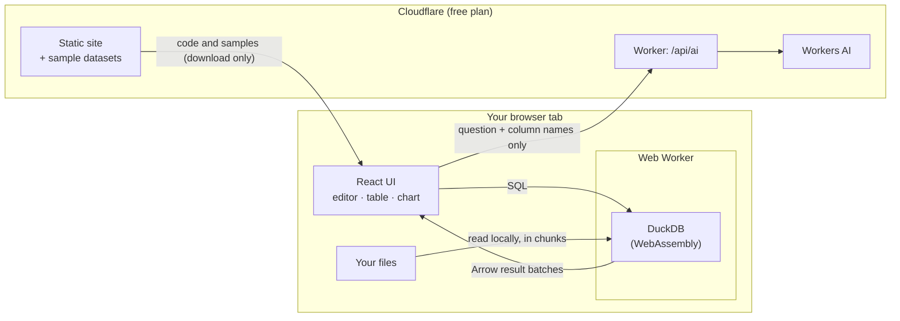

# Querylite

**Drop in a CSV and query millions of rows instantly, right in your browser. Nothing is uploaded.**

[](https://github.com/adamchebil33/querylite/actions/workflows/ci.yml)

**Live demo:** https://querylite.adamchebil.workers.dev. Click **Try it on 2.9 million taxi trips**: no file, no sign-up.

https://github.com/user-attachments/assets/cd2e3fc5-1cb8-49c6-b7bf-f55815236f4c

Querylite is a SQL playground where the database runs inside the browser tab. Drag in a CSV, TSV, JSON, Parquet or Excel file, ask questions in SQL or in plain English, and get a results table and a chart. It handles files far too big for a spreadsheet, and private data (bank exports, company sales) never leaves your computer because there is no server to send it to.

The real app, unedited:


## Measured performance

Run on the built-in [`/bench`](src/bench/benchmark.ts) page, which anyone can re-run on their own device.

Measured on Chrome 158, Linux, 6 CPU threads, 8+ GB RAM, 2026-11-21, DuckDB v1.5.4 (WebAssembly, single thread).

| Query over 2,869,937 rows | Median | Fastest |
| --- | ---: | ---: |
| Count all rows | 1.7 ms | 1.5 ms |
| Filter and aggregate | 20 ms | 18 ms |
| Group by hour (24 groups) | 39 ms | 38 ms |
| Group by route (tens of thousands of groups) | 59 ms | 59 ms |
| Join to zones and group by borough | 28 ms | 27 ms |
| Median and 95th percentile per payment type | 184 ms | 183 ms |
| Top 100 by tip (sort) | 53 ms | 52 ms |
| Daily totals with 7-day moving average (window) | 24 ms | 24 ms |

- Download and load 2,869,937 rows (18 MB Parquet): 3.0 s
- Parse a 59 MB CSV with 1,000,000 rows: 0.7 s

Each query runs once to warm up, then five times; the table shows the median and the fastest run.

## Highlights

- **Private by design, and enforced.** Your files are never uploaded: there is no server to receive them. The browser's own security policy blocks connections to any other site, so even a bug or a compromised dependency could not send your data anywhere.
- **AI that never sees your data.** Ask a question in plain English and AI drafts the SQL. Only table and column names are sent, never rows or values. AI-written SQL is accepted only if it is a single read-only `SELECT`, and it never runs until you review it.
- **Smooth with millions of rows.** The database runs off the main thread and the table only draws the rows on screen, so the page stays responsive while a million-row file loads. A test measures this.
- **Tested on every push.** Unit and browser tests run in CI and cover every file format, joins across files, sorting, charts, exports, share links, the benchmark page, responsiveness during large loads, that nothing is uploaded, and that AI requests never contain data values.
- **Runs for $0.** The site, the sample datasets and the AI feature all run on Cloudflare's free plan. If the AI is down or its free daily allowance runs out, the app says so and everything else keeps working.

## Features

- **Files:** CSV, TSV, JSON, Parquet and Excel (.xlsx). Drop several at once; each becomes a table, and joins across them work.
- **Editor:** SQL highlighting, autocomplete for table and column names, Ctrl/Cmd+Enter to run, and a Cancel button for long queries.
- **Results:** a table that scrolls 100,000 rows smoothly, click-to-sort, and a summary like `10 rows · 28 ms over 2,870,202 rows`.
- **Charts:** a bar, line or scatter chart is suggested from the shape of the result, with controls to change it.
- **AI:** describe what you want in plain English, explain a query, or fix an error in one click.
- **Export:** the full result as CSV or Parquet, even when the on-screen table is cut off.
- **Share:** a link that carries the SQL and the name of a sample dataset, never your data.
- **History and saved queries,** kept in your browser only. Light and dark mode, and a layout that works on phones.

## How it works



**A database inside the page.** [DuckDB](https://duckdb.org), a full analytical SQL database, is compiled to WebAssembly, so queries run on your own CPU with no server round trip.

**Off the main thread.** The database lives in a Web Worker and reads files there in chunks, so heavy work never blocks the interface.

**Streaming results.** Results arrive as Apache Arrow batches. The app keeps up to 100,000 rows for display and the table only draws the rows in view; exports re-run the query so they are always complete.

**A small, guarded AI endpoint.** A Cloudflare Worker forwards the question and the table schema to Workers AI, with a per-visitor rate limit. The browser builds the request from an allow-list of fields, the Worker checks it again, and DuckDB parses every AI answer before it reaches the editor.

## Tech stack

| Area | Tools |
| --- | --- |
| Frontend | React, TypeScript, Vite, Tailwind CSS |
| Database | DuckDB-WASM, Apache Arrow |
| Editor and charts | CodeMirror 6, Observable Plot, TanStack Virtual |
| Hosting and AI | Cloudflare Workers, Workers AI |
| Testing | Vitest, Playwright |

## Getting started

Requires Node.js 22 or newer.

```bash
git clone https://github.com/adamchebil33/querylite.git
cd querylite
npm install
npm run dev
```

Open the printed URL; no account or configuration is needed. The AI buttons report that AI is unavailable locally, because the model only runs on Cloudflare's network. To use it, run `npx wrangler login` once and then `npm run dev:ai`.

To deploy, `npm run deploy` builds the app and publishes the site and the AI endpoint together as one Cloudflare Worker. Its settings, such as the AI model and the rate limit (5 AI requests per minute per visitor), are in [`wrangler.jsonc`](wrangler.jsonc).

## Tests

```bash
npm test                          # unit tests (Vitest)
npx playwright install chromium   # once
npm run test:e2e                  # browser tests against the dev server
npm run test:e2e:preview          # browser tests against the production build
```

The browser tests start the app themselves and need internet access, because the database engine is downloaded from a CDN. CI runs the unit tests and the production-build browser tests on every push to `main` and on pull requests.

## Project structure

```
src/
  components/       landing page, sidebar, SQL editor, results table, chart, AI bar
  db/engine.ts      DuckDB start-up, file loading, queries, export
  state/            app state
  lib/              helpers, each with unit tests next to it
  bench/            the benchmark page
shared/ai.ts        the browser/Worker contract for AI requests
worker/index.ts     Cloudflare Worker: POST /api/ai
public/_headers     security headers, including the Content-Security-Policy
tests/e2e/          Playwright browser tests
```

## Credits

- **NYC taxi trips:** yellow taxi trip records for January 2024 and the taxi zone lookup table, from the [NYC Taxi & Limousine Commission](https://www.nyc.gov/site/tlc/about/tlc-trip-record-data.page).
- **World CO₂ emissions:** [Our World in Data](https://github.com/owid/co2-data), licensed [CC BY 4.0](https://creativecommons.org/licenses/by/4.0/).
- **Fonts:** IBM Plex Sans, Mono and Serif, under the SIL Open Font License.

## License

[MIT](LICENSE)
